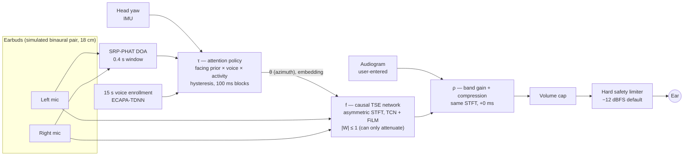
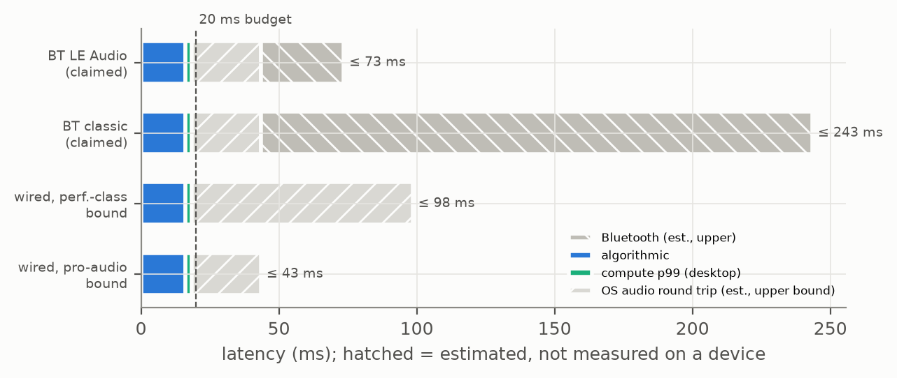
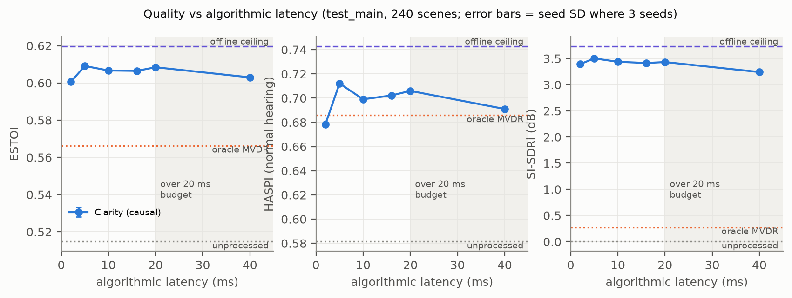

# Clarity

[](https://github.com/eshaan2418/clarity/actions/workflows/ci.yml)
  

**Hear the person you're talking to — not the room.** Clarity is a phone + earbuds research system that
isolates the voice of your conversation partner in a noisy, multi-talker room, inside a 20 ms latency
budget, steered by where you're facing and (optionally) personalised to your audiogram.

> [!IMPORTANT]
> **Not a medical device.** Clarity is a research prototype. It does not diagnose, treat or replace
> hearing aids or professional care. Any audiogram you enter is your own input and is not checked.
> All hearing-impaired results here come from a **simulated listener** (a hearing-loss model), and all
> quality results come from **simulated rooms**. There are no human listening results and no
> phone measurements yet (see [Evidence status](#evidence-status-what-is-real-and-what-is-not)).

---

## TL;DR — the research question and the answer so far

> *Can an on-device model isolate a chosen talker in noisy multi-talker scenes within ≤ 20 ms of
> algorithmic + compute latency, and give measurably higher intelligibility than noise suppression,
> classical beamforming and generic amplification?*

**On simulated binaural scenes, at reduced training scale: yes for the extraction itself; mixed for the
two "smart" add-ons.**

| | Finding | Evidence |
|---|---|---|
| ✅ **Latency** | 16 ms algorithmic + 2.50 ms p99 per-hop compute = **18.5 ms**, inside the 20 ms budget | desktop (Apple M5 Pro, C++ engine on the CoreAudio clock) |
| ✅ **Beats the baselines** | ESTOI 0.607 vs 0.515 unprocessed (paired +0.093, 95% CI [0.087, 0.098]) and vs 0.566 for an *oracle-noise* MVDR beamformer (+0.041 [0.035, 0.047]); HASPI 0.703 vs 0.581 unprocessed | 240 frozen test scenes, `results/m3/summary.md` |
| ➖ **Latency is almost free** | quality is nearly flat from 2 ms to 40 ms (ESTOI 0.601–0.609); the non-causal ceiling is only slightly higher (0.620) | reduced scale: the ceiling is weak too |
| ✅ **Attention steering works** | head-direction + DOA policy picks the right talker 0.925 of the time and gains +0.111 ESTOI over unprocessed, 0.037 short of oracle selection | `results/m4/summary_ci.md` |
| ❌ **…but the IMU didn't help** | dropping the head-tracker IMU was *better* (0.952 selection accuracy); voice identity added nothing measurable | honest negative result, see [M4](#4-attention-steered-target-selection-τ) |
| ➖ **Personalisation is mixed** | audiogram-conditioned stage beats "enhancement + NAL-R" only for moderate flat loss (HASPI 0.549 vs 0.500); worse for normal and mild hearing | simulated listener, `results/m5/summary.json` |

Every number in this README is produced by a script in [`bench/`](bench/), written to [`results/`](results/)
with git commit, hardware, seed, checkpoint hash, config and load average, and cross-checked by
[`scripts/check_numbers.py`](scripts/check_numbers.py) (CI fails on any unbacked number).

---

## Listen

Synthetic restaurant scene, 0 dB SNR, four competing talkers + babble + clatter, left-ear signal
(LibriSpeech speech, synthetic noise — redistributable). Processed hop-by-hop by the exported ONNX
model, steered by the attention policy, through device volume and the safety limiter.

| Scene | Unprocessed | Clarity | Clean target (reference) | ESTOI unprocessed → Clarity |
|---|---|---|---|---|
| Facing the partner | [▶︎ wav](results/demo/audio/synthetic_demo_faced_unprocessed.wav) | [▶︎ wav](results/demo/audio/synthetic_demo_faced_clarity.wav) | [▶︎ wav](results/demo/audio/synthetic_demo_faced_target_reference.wav) | 0.382 → **0.486** (oracle direction: 0.504) |
| Partner 21° off-axis *(failure case)* | [▶︎ wav](results/demo/audio/synthetic_demo_off_axis_unprocessed.wav) | [▶︎ wav](results/demo/audio/synthetic_demo_off_axis_clarity.wav) | [▶︎ wav](results/demo/audio/synthetic_demo_off_axis_target_reference.wav) | 0.299 → 0.255 (oracle direction: 0.430) |

The second row is deliberately included: "focus on who I'm facing" locks onto whoever is nearest your
nose. The extractor itself is fine (0.430 with the true direction); the *selection* is what fails.
Numbers: [`results/demo/demo.json`](results/demo/demo.json) · script: [`DEMO.md`](DEMO.md).

---

## How it works



**Three contributions**, each evaluated with ablations:

1. **τ — attention-steered target selection.** Tracks talkers in the world frame (IMU yaw + interaural
   DOA), fuses a "people face whom they listen to" prior with voice similarity to enrolled people, and
   switches with hysteresis when you turn. Degrades to direction-only (no enrollment) or voice-only
   (single mic). [`clarity_tse/select/policy.py`](clarity_tse/select/policy.py)
2. **f, ℓ — ultra-low-latency streaming extraction.** A ~2 M-parameter causal TCN on an asymmetric-window
   STFT (long analysis window, short synthesis window), so algorithmic latency is just 2 × hop. It
   predicts bounded complex per-mic weights — a learned, time-varying beamformer that can attenuate but
   never amplify a time–frequency bin ("fail by attenuating"). Explicit streaming state; chunked == batch
   and ONNX == PyTorch are unit-tested. [`clarity_tse/models/tse.py`](clarity_tse/models/tse.py)
3. **ρ — listener personalisation.** An audiogram-conditioned band-gain/compression stage applied in the
   extractor's own STFT (zero added latency, unlike a NAL-R FIR), trained on a differentiable
   intelligibility proxy — *not* on HASPI, the evaluation metric. [`clarity_tse/personalize/rho.py`](clarity_tse/personalize/rho.py)

The same exported ONNX graph runs in Python, in the **C++ real-time engine** ([`rt/`](rt/): pre-bound
ONNX Runtime I/O, no allocation or locks in the audio callback, limiter in the chain) and in the
**Android app** ([`android/`](android/): Kotlin + Oboe/AAudio, enrollment, audiogram entry, A/B switch,
loopback latency test, no INTERNET permission).

---

## Latency, accounted honestly

Three latency types are always reported separately, each with its evidence stage.



| Component | Value | Stage |
|---|---|---|
| Algorithmic (synthesis window 2 × 8 ms hop, no look-ahead) | 16 ms | exact (from config) |
| Compute, per hop, p99 (inside the CoreAudio IO callback, 60 min) | 2.50 ms | `desktop` |
| **Algorithmic + compute** (the 20 ms budget) | **18.5 ms** | `desktop` |
| OS audio round trip, wired | ≤ 25 ms (Android pro-audio requirement) | `estimated` — requirement bound, not a measurement |
| Bluetooth link | ~20–30 ms (LE Audio, claimed) / ~100–200 ms (classic, claimed) | `estimated` — published claims |

Consumer Bluetooth is **not** inside the 20 ms budget and nothing here implies otherwise. The app has a
loopback measurement mode; on-device numbers need a phone ([`HUMAN_TODO.md`](HUMAN_TODO.md) §2).
Sources: [`results/m7/system_latency.json`](results/m7/system_latency.json).

---

## Results

All on the frozen `test_main` set: **240 scenes** (restaurant, party, street, kitchen × SNR −5…15 dB ×
12), test-clean speakers never seen in training, ESC-50 fold 5, 6 s, slow head drift, 10 s enrollment,
per-array SHA-256 checksums. Mean [95% bootstrap CI]; paired Wilcoxon tests, Holm-corrected.

### 1. Quality vs latency (contribution 2)



| Budget | Algorithmic | Seeds | MMAC/s | SI-SDRi (dB) | ESTOI | HASPI |
|---|---|---|---|---|---|---|
| 2 ms | 2 ms | 1 | 2014 | 3.39 | 0.601 | 0.678 |
| 5 ms | 5 ms | 1 | 806 | 3.50 | 0.609 | 0.712 |
| 10 ms | 10 ms | 1 | 403 | 3.44 | 0.607 | 0.699 |
| **16 ms (operating point)** | 16 ms | 3 | 252 | 3.41 ± 0.01 | 0.606 ± 0.001 | 0.702 ± 0.001 |
| 20 ms | 20 ms | 1 | 201 | 3.43 | 0.608 | 0.706 |
| 40 ms | 40 ms | 1 | 127 | 3.24 | 0.603 | 0.691 |
| Non-causal ceiling | whole utterance | 1 | 326 | 3.73 | 0.620 | 0.743 |

± = SD over 3 training seeds (seed variance is tiny). Full table with CIs, PESQ and DNSMOS:
[`results/m3/summary.md`](results/m3/summary.md).

**Ablations at the operating point** (paired, vs `b16_s0`):

| Change | ΔSI-SDRi (dB) | ΔESTOI | Reading |
|---|---|---|---|
| no distillation from the ceiling | −0.217 | −0.006 | distillation helps, slightly |
| no direction at inference (voice only) | −14.490 | −0.213 | **the model leans almost entirely on direction** |
| no voice embedding at inference (direction only) | −0.142 | −0.002 | enrollment adds little |

More ablations (artifact loss, target-absent training, 1-mic model, curriculum) are training — see
[`PROGRESS.md`](PROGRESS.md).

### 2. Against the baselines

| System | SI-SDRi (dB) | ESTOI | HASPI | DNSMOS OVRL |
|---|---|---|---|---|
| Unprocessed (left ear) | −0.00 | 0.515 | 0.581 | 1.40 |
| RNNoise (single-channel noise suppression) | −4.65 | 0.406 | 0.326 | 2.14 |
| Delay-and-sum, true direction | −0.38 | 0.534 | 0.620 | 1.49 |
| MPDR, true direction | −1.95 | 0.520 | 0.621 | 1.44 |
| MVDR, true direction **+ oracle noise covariance** | 0.27 | 0.566 | 0.686 | 1.57 |
| **Clarity, 16 ms** | **3.43** | **0.607** | **0.703** | 2.02 |

RNNoise makes speech *sound* cleaner (best DNSMOS) while lowering every intelligibility metric in babble —
the classic gap between "less noise" and "more understandable". [`results/m2/summary.md`](results/m2/summary.md)

### 3. Attention-steered target selection (τ)

40 test scenes × 12 s: turning between two partners, a same-sounding distractor, a moving partner,
a partner who pauses. Policy parameters were tuned on **validation-split** scenes only.

| Variant | ESTOI | Selection accuracy | Wrong-talker rate |
|---|---|---|---|
| Oracle selection (true direction + voice) | 0.471 | — | — |
| **Full policy** (IMU + DOA + voice) | 0.434 | 0.925 | 0.039 |
| − IMU (head-frame tracking) | 0.449 | 0.952 | 0.006 |
| − voice | 0.435 | 0.929 | 0.032 |
| − DOA (voice only) | 0.375 | — | — |
| "Focus on this voice" mode | 0.361 | 0.537 | 0.198 |
| Unprocessed | 0.324 | — | — |

**Negative result:** in simulation the IMU hurt (−0.014 ESTOI vs no IMU, Holm p = 1.2e-06). Our reading:
2-mic lateral DOA is biased at large angles, so world-frame tracks split during head turns, while
head-frame tracking needs no cross-turn consistency. The case where an IMU should matter — a partner who
is *silent* while you turn — isn't in these scenarios. [`results/m4/summary_ci.md`](results/m4/summary_ci.md)

### 4. Listener personalisation (ρ) — simulated listeners

HASPI v2 with each profile's audiogram (synthetic profiles, mild → severe, flat and sloping).

| System | Normal | Mild flat | Mild sloping | Moderate flat | Moderate sloping | Severe sloping |
|---|---|---|---|---|---|---|
| Unprocessed | 0.600 | 0.560 | 0.526 | 0.309 | 0.454 | 0.357 |
| NAL-R only ("generic amplification") | 0.600 | 0.569 | 0.576 | 0.442 | 0.543 | 0.469 |
| Clarity + NAL-R | 0.696 | 0.644 | 0.634 | 0.500 | 0.590 | 0.501 |
| Clarity + ρ (audiogram-conditioned) | 0.637 | 0.583 | 0.597 | **0.549** | 0.559 | **0.508** |
| Clarity + ρ (fine-tuned per listener) | 0.638 | 0.581 | 0.602 | 0.545 | 0.561 | 0.490 |

Enhancement before amplification helps every profile; the learned ρ stage only beats NAL-R for moderate
flat loss, is not the identity for normal hearing, and per-listener fine-tuning adds nothing. NAL-R as a
linear-phase FIR adds 6.9 ms of delay; ρ adds 0 ms. [`results/m5/summary.json`](results/m5/summary.json)

### 5. Real-time engine

60-minute run of the C++ engine on the real CoreAudio clock (48 kHz device, 256-frame buffer, muted
output, operating-point model): per-hop compute p50 1.66 ms / p99 2.50 ms / p99.9 2.74 ms against an
8 ms hop (RTF 0.21). On a heavily shared host (load average 48–68 on 18 cores, two training jobs and
eight evaluation workers running) the run had 14 glitches (6 late callbacks, 8 OS overload notices;
worst single stall 46.6 ms), so the zero-glitch goal is **not yet met**; an unloaded rerun is pending. [`results/m6/`](results/m6/)

### 6. Real recordings and the listening study

* **Real recordings (M9):** blocked — none recorded yet (consent required). The pipeline (DNSMOS +
  target-talker ASR word error rate) is ready and validated on simulated single-sentence stimuli:
  WER 0.669 Clarity vs 0.778 MPDR vs 1.125 unprocessed (WER > 1 from babble insertions).
* **Listening study (M10):** complete package — protocol, consent form, local-only browser test
  (word recognition, listening effort, MUSHRA with hidden reference + anchor, calibration noise),
  Latin-square randomisation, keyword scoring and mixed-effects analysis, dry-run on simulated
  participants. Planning power for a +10 pp effect with 16 participants: 0.835 (assumed effect sizes).
  Running it needs ethics approval and people — see [`study/PROTOCOL.md`](study/PROTOCOL.md).

---

## Evidence status: what is real and what is not

| Claim type | Status |
|---|---|
| Speech quality / intelligibility metrics | ✅ measured, **simulated rooms** (LibriSpeech + ESC-50/synthetic noise, image-source RIRs, free-field 2-mic array, no HRTF) |
| Hearing-impaired intelligibility | ⚠️ **simulated listener** (HASPI v2 hearing-loss model) |
| Algorithmic latency | ✅ exact |
| Compute latency | ✅ `desktop` (Apple M5 Pro); ❌ no phone measurements |
| System latency (mic → ear) | ⚠️ `estimated` from platform requirements and published claims |
| Energy / battery | ⚠️ `estimated` (assumption ranges) — no device |
| Human word recognition / ratings | ❌ not run (study package ready, awaiting ethics + participants) |
| Real-world recordings | ❌ none yet |

Models are small (~2 M parameters) and trained for 6000 steps on one shared laptop GPU, so absolute
numbers are far below published state of the art; comparisons use the same budget for every model.

---

## Quick start

```bash
make setup            # uv sync --frozen (Python 3.12)
make test             # unit tests on generated fixtures — no downloads needed
make rt rt-test       # C++ engine (needs ONNX Runtime: brew install onnxruntime)
make reproduce-quick  # < 1 h: lint, types, tests, tiny train+eval, study dry run, number check, repo scan

make data             # LibriSpeech (CC BY 4.0), ESC-50, DNSMOS, RNNoise
make reproduce-full   # every experiment from scratch (~1–2 days on one laptop GPU)
make demo             # the listening examples above
make android          # APK + unit tests (JDK 17, Android SDK 35, NDK 27)
```

<details>
<summary><b>Repository layout</b></summary>

```
clarity_tse/          Python package
  synth/              scene simulator: rooms, 2–6 talkers, babble, noise, head rotation, binaural rendering
  dsp/                low-latency STFT, beamformers (DS/MVDR/MPDR), DOA (SRP-PHAT/GCC-PHAT), safety limiter
  embed/              ECAPA-TDNN speaker embeddings (frozen, SpeechBrain)
  models/             streaming + non-causal TSE network, losses
  select/             attention policy τ
  personalize/        audiograms, ρ stage, NAL-R
  eval/               SI-SDR, PESQ, STOI/ESTOI, HASPI/HASQI, DNSMOS, ASR WER, latency harness, statistics
  baselines/          unprocessed, RNNoise, delay-and-sum, MPDR, oracle MVDR
bench/                every experiment and figure (train, evaluate, sweep, export, demo, figures)
rt/                   C++ real-time engine + benchmarks (CMake)
android/              Kotlin + NDK app (Gradle)
study/                listening-study protocol, consent, web tool, randomisation, analysis
paper/                LaTeX draft; tables and figures regenerate from results/
results/              all outputs with provenance (INDEX.md lists every experiment)
configs/              training configs (sweep generated by bench/make_configs.py)
```
</details>

Project state lives in [`PROGRESS.md`](PROGRESS.md) · decisions in [`DECISIONS.md`](DECISIONS.md) ·
fallbacks and their impact in [`BLOCKERS.md`](BLOCKERS.md) · things only a human can do in
[`HUMAN_TODO.md`](HUMAN_TODO.md) · experiment log in [`results/INDEX.md`](results/INDEX.md).

---

## Safety and privacy

* **Hearing safety:** every playback path (Python, C++, Android, study server) ends in a hard limiter;
  the user volume is capped, the ceiling defaults to a conservative −12 dBFS and can never exceed
  −1 dBFS. Tests try to bypass it (NaN/inf inputs, mutating the ceiling after construction, huge gains).
  The A/B "off" path is limited too.
* **Privacy:** the Android app has no INTERNET permission; enrollments and audiograms stay on the phone.
  Personal recordings, enrollments, study responses and credentials are git-ignored and the repo scan
  ([`scripts/scan_repo.sh`](scripts/scan_repo.sh)) fails on audio, personal paths or large files in history.
* **Consent:** never record or process people without their consent; the study must not run without
  ethics approval.

## Data and attribution

Speech: [LibriSpeech](https://www.openslr.org/12) (CC BY 4.0, Panayotov et al. 2015) — the audio
examples in `results/demo/audio/` are derived from it. Noise: [ESC-50](https://github.com/karolpiczak/ESC-50)
(CC BY-NC 3.0, used locally, never redistributed) and synthetic noise. Speaker embeddings: SpeechBrain
ECAPA-TDNN (Apache-2.0). Metrics: pyclarity (HASPI/HASQI/NAL-R), pesq, pystoi, Microsoft DNSMOS. ASR:
torchaudio wav2vec 2.0. Gated datasets (Clarity Challenge, WSJ0) are not used.

Related work this builds on is cited in [`paper/refs.bib`](paper/refs.bib) — notably Conv-TasNet,
SpeakerBeam, VoiceFilter(-Lite), Wang et al.'s very-low-latency STFT enhancement, ClearBuds, Look Once to
Hear, HASPI and the Clarity Challenge.
